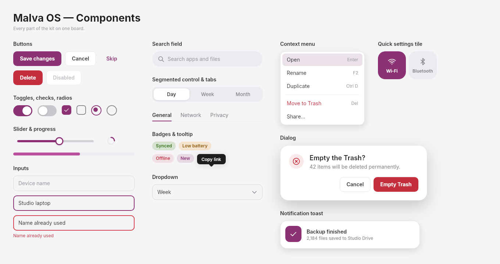
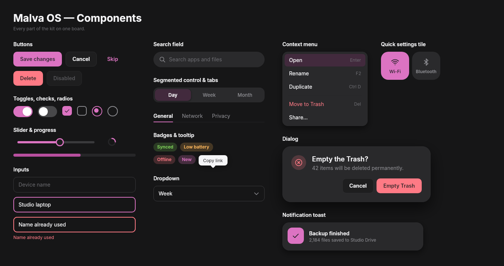
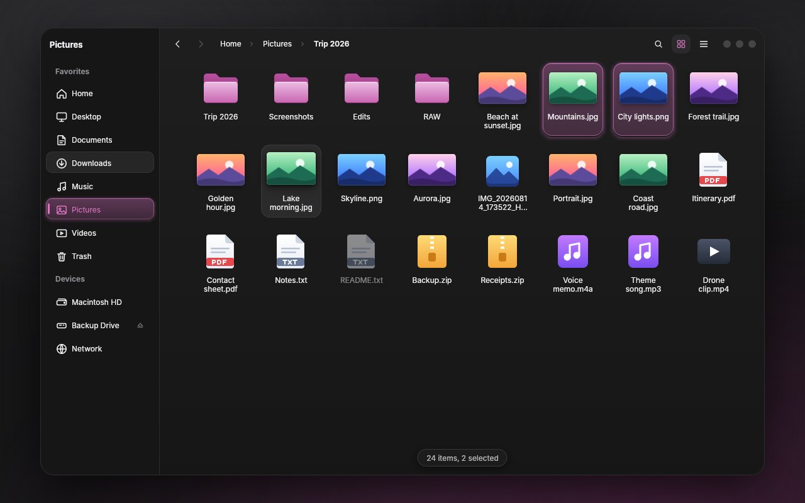
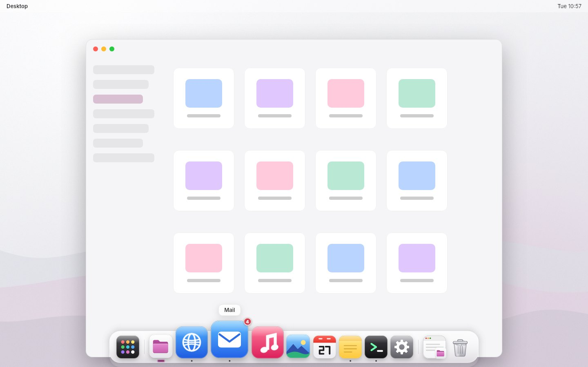
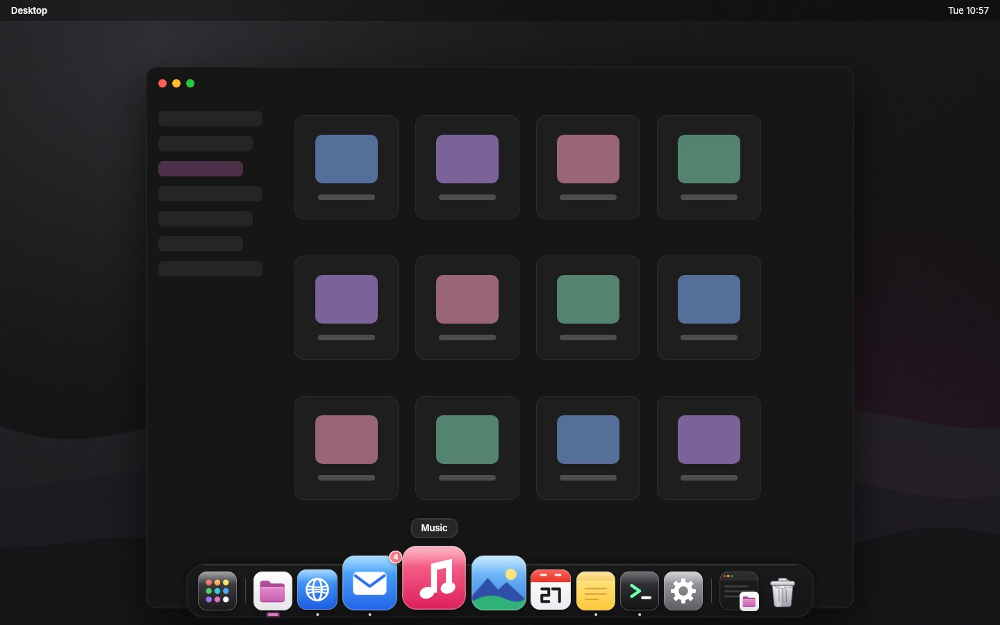
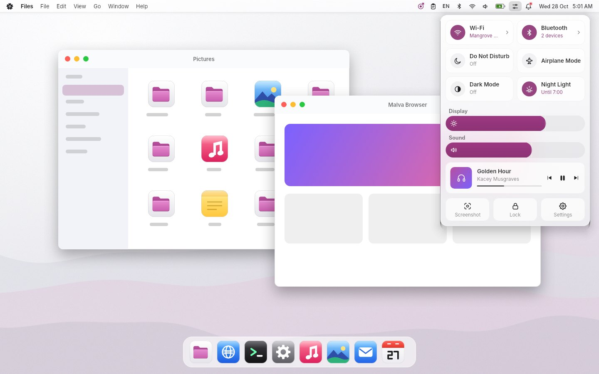
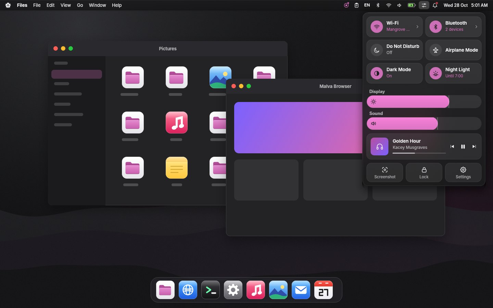
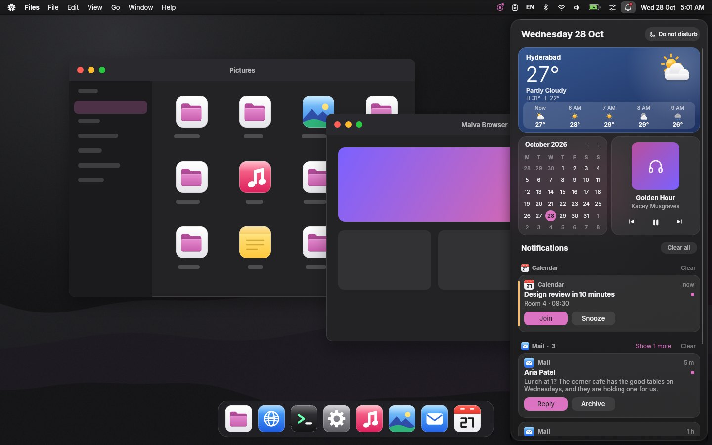
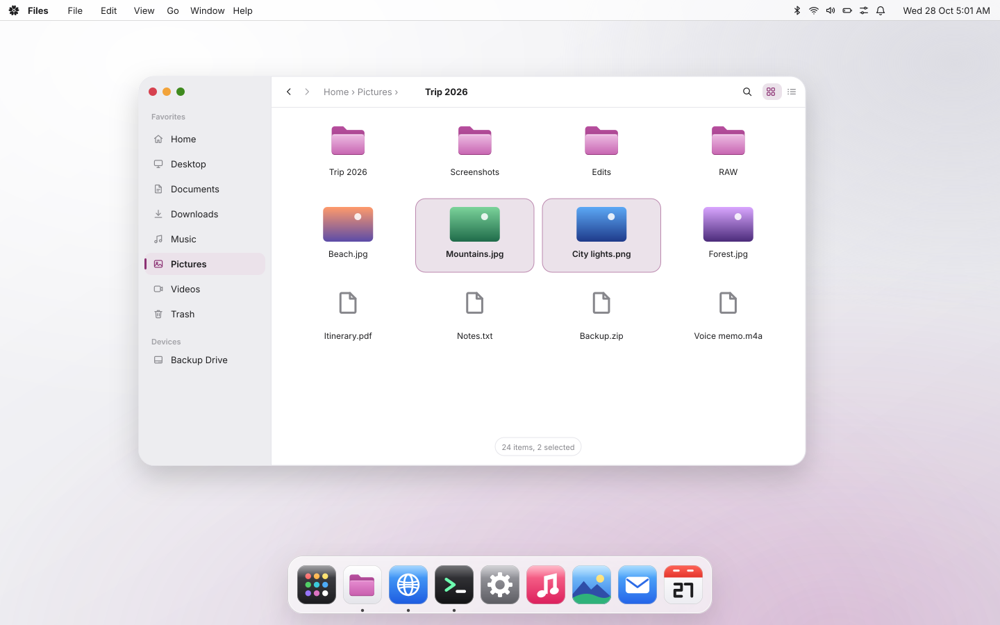
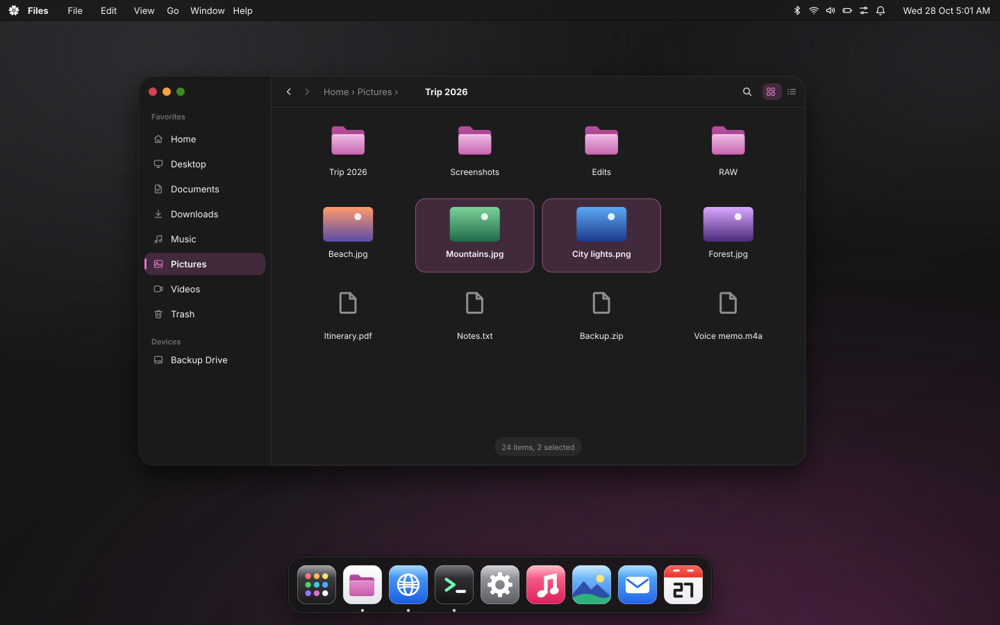

# Malva UI kit

The design system of Malva OS as code: **tokens** (one JSON file) that generate the **Slint**, **C++**, **Rust**, **CSS**
and **SVG** sides, a **Slint component library** with 69 exported parts, an **iced** theme, 130 symbols and 20 app icons
as **SVG**, and the **Files app, dock and menu bar** rebuilt on top of it.




## Screenshots

**Captured from the running Slint UI** (`docs/screenshots`, rendered by `slint-viewer` 1.18.1):

| | Light | Dark |
|---|---|---|
| Components, every state | [buttons](docs/screenshots/buttons-light.png), [controls](docs/screenshots/controls-light.png), [inputs](docs/screenshots/inputs-light.png), [navigation](docs/screenshots/navigation-light.png), [feedback](docs/screenshots/feedback-light.png), [surfaces](docs/screenshots/surfaces-light.png), [window chrome](docs/screenshots/windowchrome-light.png), [typography](docs/screenshots/typography-light.png) | the same eight, `-dark.png` |
| Files |  |  |
| Dock |  |  |
| Menu bar, Control Center |  |  |
| Notification centre |  |  |

All 36 app scenes are in `docs/screenshots/apps/`.

**Vector previews** (`docs/svg`, SVG): the same screens drawn from the tokens, the kit's icons and its wallpapers by
`tools/make_svg_screens.py`. They are drawings, not captures (Slint cannot export a window to SVG), so they match the
design but not every pixel of the running UI. They scale without loss, and open in a browser, Inkscape or Figma.

| | Light | Dark |
|---|---|---|
| Desktop |  |  |
| Files | [files-light.svg](docs/svg/files-light.svg) | [files-dark.svg](docs/svg/files-dark.svg) |
| Dock | [dock-light.svg](docs/svg/dock-light.svg) | [dock-dark.svg](docs/svg/dock-dark.svg) |
| Menu bar and Control Center | [menubar-light.svg](docs/svg/menubar-light.svg) | [menubar-dark.svg](docs/svg/menubar-dark.svg) |
| Every component on one sheet | [specimen-light.svg](svg/specimen-light.svg) | [specimen-dark.svg](svg/specimen-dark.svg) |

The SVGs set text in Inter; on a machine without it the system UI font is used.

## The look in one paragraph

Black and white, with the logo's colour. Every surface, text colour and border is a neutral (light: `#F5F5F7` canvas,
`#FFFFFF` cards, `#1D1D1F` text, `#86868B` secondary text, `#E5E5EA` hairlines; dark: `#161617` canvas, `#1E1E1F`
windows, `#F5F5F7` text, `#8E8E93` secondary text, `#2C2C2E` borders). The one strong colour is the logo's
Plum `#8C3274` (the lighter orchid-pink `#DC73C2` in dark), and it appears only where something can be acted on or is
selected: primary buttons, the on state of a switch, selection, focus, links. See [docs/DESIGN.md](docs/DESIGN.md).

## What is in the box

| Folder | What | Language |
|---|---|---|
| `tokens/malva-tokens.json` | **The single source of truth**: palette, 56 colour roles in light and dark, radii, spacing, sizes, type, motion, elevation | JSON |
| `slint/` | The component library (`@malva/malva.slint`), tokens, icons, Inter and JetBrains Mono. 69 exports: Button, Toggle, Slider, TextField, Dropdown, Tabs, Card, Toast, Dialog, ContextMenu, TitleBar, ... ([reference](docs/COMPONENTS.md)) | Slint |
| `cpp/` | Header-only `malva::` colour maths, tokens, theme, motion and icons (usable without Slint), CMake target `Malva::UI`, the interaction test of every component, a gallery app | C++20 |
| `rust/` | `malva-color`, `malva-tokens`, `malva-icons`, `malva-motion` (std only, `cargo test` works offline) and `malva-iced`, the theme for [iced](https://iced.rs) 0.14 | Rust |
| `css/malva.css` | Every token as a custom property; dark by `prefers-color-scheme` or `data-theme="dark"` | CSS |
| `svg/` | `icons/` (130 symbols, `currentColor`), `app/` (20 app pictures), `logo/` (the brand kit's 14 files), `wallpaper/`, `parts/` (squircle, focus ring, spinner, skeleton, elevation), `specimen-light.svg`, `specimen-dark.svg`, `palette.svg`, `icons-sheet.svg` | SVG |
| `apps/` | **Files**, **dock** and **menu bar**, each a Slint UI with a small replaceable C++ backend, ported onto the kit's tokens | Slint + C++ |
| `dist/` | `malva.dtcg.json` (W3C design tokens, for Figma and Style Dictionary), `malva.gpl` (palette for GIMP / Inkscape / Krita), `resolved.json` (every role as hex, the golden file the tests compare against) | JSON |
| `gallery/` | The design sheets (every component in every state) and their light and dark windows | Slint |
| `tools/` | The generators. Python 3, standard library only (the preview wallpapers in `apps/*/tools` also use numpy and Pillow) | Python |
| `docs/` | `DESIGN.md`, `USAGE.md`, `COMPONENTS.md`, `TOKENS.md`, `ICONS.md`, `screenshots/` (captures), `svg/` (vector previews) | Markdown, PNG, JPG, SVG |

## Quick start

**Slint** (any language that hosts Slint):

```slint
import { Theme, Button, ButtonKind, TextField, Toggle } from "@malva/malva.slint";

export component App inherits Window {
    default-font-family: "Inter";
    background: Theme.bg;
    // Theme.dark = true;  switches every colour of every component
    Button { text: "Save"; kind: ButtonKind.primary; clicked => { /* ... */ } }
}
```

```sh
slint-viewer -L malva=slint your-app.slint        # preview
```

**C++ / CMake**:

```cmake
find_package(Slint 1.18 REQUIRED)
add_subdirectory(malva-ui-kit/cpp malva)                    # Malva::UI, and malva_add_slint()
add_executable(app main.cpp)
malva_add_slint(app ui/app.slint)                           # slint_target_sources with @malva wired up
target_link_libraries(app PRIVATE Malva::UI Slint::Slint)
```

```cpp
#include <malva/theme.h>
malva::Theme theme(malva::Mode::Dark);
auto accent = theme.colors().accent;                        // the same bytes the Slint side uses
```

**Rust**: `malva_tokens::colors(Mode::Dark).accent`, `malva_icons::svg_with_color("bell", "#8C3274")`,
`malva_iced::theme(mode)` ([malva-iced/README.md](rust/malva-iced/README.md)). **CSS**: `<link rel="stylesheet" href="css/malva.css">`,
then `background: var(--malva-bg)`.

More in [docs/USAGE.md](docs/USAGE.md).

## Changing the design

Edit `tokens/malva-tokens.json`, then:

```sh
python3 tools/gen_tokens.py        # Slint, C++, Rust, CSS, DTCG, GPL, resolved.json, palette.svg, docs/TOKENS.md, test fixtures
python3 tools/gen_icons.py         # icon lookups for Slint, C++, Rust; icon sheet; docs/ICONS.md
python3 tools/make_svg_parts.py    # svg/parts and the two specimen sheets
python3 tools/gen_components_doc.py
python3 tools/make_svg_screens.py  # the vector previews in docs/svg
```

Each takes `--check` (exit 1 if something on disk differs from what the sources say), which is how you keep generated
files honest in CI (`.github/workflows/ci.yml` does). Generated files start with `GENERATED by ... Do not edit by hand.`

## Build and test

Needs: CMake 3.21+, a C++20 compiler, the [Slint 1.18 C++ SDK](https://github.com/slint-ui/slint/releases) (for the Slint
parts), Rust 1.75+ (for `rust/`), Python 3.

```sh
cmake -S . -B build -DCMAKE_BUILD_TYPE=Release -DCMAKE_PREFIX_PATH=/path/to/Slint-cpp-1.18.1-Linux-x86_64 -DMALVA_BUILD_APPS=ON
cmake --build build -j
(cd build && ctest --output-on-failure)       # 10 tests; the Slint ones need no display (Slint's testing backend)
(cd rust && cargo test --offline)             # 26 tests
```

Without Slint, `cmake -S . -B build` still builds and tests the header-only C++ (colour, tokens, motion).
A complete outside project is `cpp/examples/consumer/` (a CMake file, one `.slint`, one `main.cpp`).

## What is tested, and what is not

Everything below was run in the environment this kit was written in (Linux, Slint 1.18.1, GCC, Rust stable).

| | |
|---|---|
| Colour maths, tokens and motion in C++ and Rust agree byte for byte with each other and with `dist/resolved.json` and `dist/motion-golden.json`, both modes | **tested** (`color_test`, `tokens_test`, `motion_test`, the Rust golden tests) |
| WCAG contrast of the text pairings, both modes | **tested**, with two stated exceptions: `text-2` (`#86868B` on white is 3.6:1) and `muted` are held to 3.0 and 2.5, because they are your specified greys; use them for supporting text only |
| Every interactive Slint component: pointer, keyboard, focus, scrolling, timers (`ui_test`, 12 sections, over 100 checks; writing it found and fixed several real bugs) | **tested** on Slint's testing backend |
| Files, dock and menu bar: model tests and end-to-end tests through the UI | **tested** (`files_*`, `dock_*`, `menubar_*`) |
| Rust crates: 26 tests | **tested** |
| Screenshots (`docs/screenshots`) | rendered by `slint-viewer` 1.18.1 with the femtovg renderer under Xvfb, from these exact files |
| `malva-iced` style functions return the right token for every status, light and dark (34 tests) | **tested against a stub** of iced whose style structs are extracted verbatim from iced 0.14.0 |
| `malva-iced` builds and runs against the real iced from crates.io; `examples/gallery.rs` | **not tested** (crates.io was not reachable) |
| The Slint library from Rust (`slint-build` with a library path) | **not tested** (the C++ and `slint-viewer` routes are) |
| Windows and macOS builds, Skia and software renderers, real compositors (blur behind the dock and bar), screen readers | **not tested** |
| The three apps against real system services (files, network, audio, notifications) | **not tested**: their backends are stand-ins to replace |

Slint draws no backdrop blur: the dock and the bar show a translucent plate, and a compositor (or the apps' blurred
backdrop image, as in the screenshots) supplies the blur.

## Licences

The kit's own licence is not chosen yet (no `LICENSE` file is included; the Cargo manifests say `publish = false`).
Fonts keep their own: Inter and JetBrains Mono are under the SIL Open Font License (`slint/fonts/*-LICENSE.txt`,
`*-OFL.txt`).
