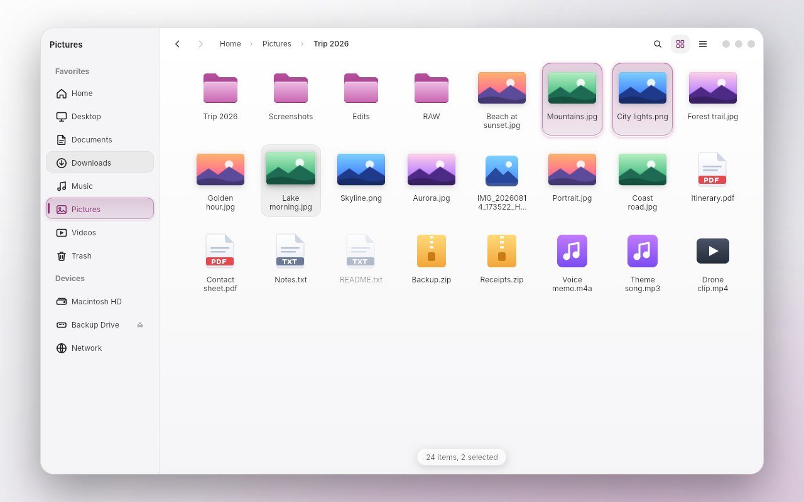

# Files: the Slint frontend

The redesigned Files app for Malva OS as a **Slint** user interface with **SVG** assets, and a
deliberately small **C++ backend** that you are meant to replace. The UI owns all drawing and all
motion; the backend only says what is in the folder and hears what the person did.



| | |
|---|---|
| `../../docs/screenshots/apps/files-*.jpg` | The four preview scenes (`preview/preview.slint`): sample data on a wallpaper, one item drawn as hovered; icons and list, light and dark. |

**Built on the Malva kit.** `ui/theme.slint` maps the app's names onto the kit's `Theme`, `Radius` and `Typo`
(`@malva/malva.slint`), so the app follows `tokens/malva-tokens.json`: neutral off-white and graphite surfaces, with the
logo's plum / orchid as the only strong colour (selection, the active sidebar item, focus).

## What is here

```
ui/
  files.slint            the one file a backend compiles; exports FilesWindow, FileEntry, Place, Theme, Motion
  files-window.slint     the Window: every property and callback a backend uses, in one flat list
  theme.slint            Theme (colours, radii, light/dark) and Motion (durations) globals
  types.slint            FileEntry, Place
  components/            FilesApp, Sidebar, Header, FileGrid/GridItem, FileList/ListRow, Scroller, surfaces
  icons/                 33 SVGs: symbolic (tinted by the theme) and coloured file-kind icons
preview/                 design scenes with sample data (nothing here ships)
backend/                 the stand-in backend (replace it)
  fs.*                   file system layer: listing, sorting, sizes, dates, places, crumbs. No Slint.
  thumbnails.*           a naive picture loader
  app.*                  wires the window's callbacks to the file system layer
  main.cpp               arguments, run loop, --snapshot
tests/                   fs_test (pure logic), app_test (the window and backend, driven through the UI)
```

## Build and run

You need the Slint C++ SDK 1.18 (it was built and tested against 1.18.1; other versions are untested), CMake 3.21 and a C++20 compiler.

```sh
cmake -S . -B build -G Ninja -DCMAKE_PREFIX_PATH=/path/to/Slint-cpp-1.18.1-Linux-x86_64 -DCMAKE_BUILD_TYPE=Release
cmake --build build
./build/files [folder] [--dark] [--list] [--frameless] [--accent=#8c3274] [--icon-size=64]
```

Use a GPU renderer (`SLINT_BACKEND=winit-femtovg`, or Skia if your Slint has it). Slint's software
renderer draws no blurred shadows (thumbnail and status chip lose their shadows) and shows banding in
the sidebar's long soft gradient.

To look at the UI without a backend: `slint-viewer preview/preview.slint --component PreviewDark`.

## Writing your backend

Compile `ui/files.slint`, then `#include "files.h"` and create a `FilesWindow`. `backend/app.cpp`
is a complete working example of everything below.

**Give it** (properties on `FilesWindow`, all with `set_` setters):

| property | meaning |
|---|---|
| `entries` `[FileEntry]` | the items showing, already sorted and filtered |
| `places` `[Place]`, `selected-place` | sidebar rows (a header row has `is-header`); index of the place holding the folder, -1 for none |
| `crumbs` `[string]`, `folder-name` | the path bar, and the sidebar title |
| `view-mode` | 0 icons, 1 list |
| `can-back`, `can-forward` | enables the buttons |
| `sort-column` (`name` `modified` `size` `kind`), `sort-ascending` | the list's heading arrow |
| `status`, `empty-text` | the chip under the items (empty hides it); the text of an empty folder |
| `icon-size` | logical pixels, default 64 |
| `dark`, `accent` | the look; set from the desktop's settings |
| `frameless` | set before `show()`: own rounded corners, edge, window buttons and a dragging header |

`FileEntry`: `name`, `kind` (`folder` `image` `pdf` `text` `archive` `audio` `video` `file`),
`thumbnail` + `has-thumbnail`, `selected`, `hidden`, and the list's strings `size`, `modified`, `kind-label`.
**Value-initialise it** (`FileEntry row {};`): Slint's generated struct leaves its bools unset.

**Hear it** (`on_...` callbacks): `item_pressed(index, ctrl, shift)`, `item_activated(index)`,
`item_context(index, x, y)`, `background_pressed`, `background_context(x, y)`, `place_clicked`,
`place_context`, `eject_clicked`, `back`, `forward`, `crumb_clicked(i)`, `path_accepted(text)`,
`search_edited(text)`, `view_mode_selected(mode)`, `sort_requested(column)`, `window_control("minimize"
| "maximize" | "close")`, `window_drag(dx, dy)`, and `key_command(name, ctrl, shift)` with names `up`
`down` `left` `right` `home` `end` `open` `parent` `back` `forward` `select-all` `toggle-hidden`
`clear-selection` `delete`.

**Call it** (`invoke_...`): `folder_opening()`, `reveal(index)`, `open_editor()`, `focus_items()`.

Two rules that are easy to miss:

1. **Selection is yours.** The UI never changes `selected` itself; change the rows you mean to
   (`set_row_data`) and the cards animate in and out. Hover is the UI's.
2. **Call `invoke_folder_opening()` before replacing `entries` when a folder opens**, for the items to
   arrive one after another. Do not call it for a refresh, a sort or a filter; those just change.

`out` properties you can read: `columns` (items per row of the icon view, for the arrow keys),
`editing` / `editor-text` (the path field).

## Motion and colour

Everything tunable is in `ui/theme.slint`: `Motion` (hover in 140 ms, out 220 ms; selection 260 ms with a
small overshoot; the sidebar pill's glide 300 ms; entrances 340 ms staggered 12 ms for the first 24
items) and `Theme` (palettes, the selection card's gradient, border, glow and sheen strengths, thumbnail
shadow strengths, radii). Selection glow is drawn as fading 1 px rings rather than a blur, so it never
tints the glass it lights.

## Tested, and not

Verified here: the UI compiles; it renders in light and dark, icon and list views, with the GL and
software renderers; the C++ backend builds and runs against the SDK; `ctest` runs `fs_test` and
`app_test` (`-DFILES_APP_TEST=ON`, needs Slint's testing backend, which the SDK has). `app_test`
clicks real items, header buttons, a column heading, a crumb and a sidebar row, sends real key
presses, double-clicks, and checks selection, navigation and history, search, sort, hidden files and
typed paths. Running the real app and this test found four real bugs, all fixed: blank icons from an uninitialised
bool, long paths overflowing the path bar, a scroll layer that swallowed every click and hover, and the keyboard
cursor not resetting after the selection was cleared.

**Not verified:** the animations were never watched running: this was built without a screen or GPU
session, so timings and curves are specified but their feel is untested. Nor were real mouse hover on
a desktop, wheel scrolling (it is Slint's own Flickable), high-DPI scales, or a Wayland compositor.

**Not included:** rubber-band selection, drag and drop, rename, the context menus themselves (the
callbacks fire; you draw the menu), copy/trash/delete, a system icon theme (icons are the SVGs in
`ui/icons`), real thumbnail generation (`thumbnails.cpp` decodes whole pictures, at most 300 a folder),
frameless-window edge resizing, and moving a frameless window on Wayland (`set_position` is ignored
there; use an X11 session or the system frame). Frameless windows need a compositor that blends alpha.

## Licence

No licence is applied to these files; choose one that suits where they go. Slint itself is offered under
GPL-3.0, a royalty-free licence, or a commercial one: check which applies to you.
