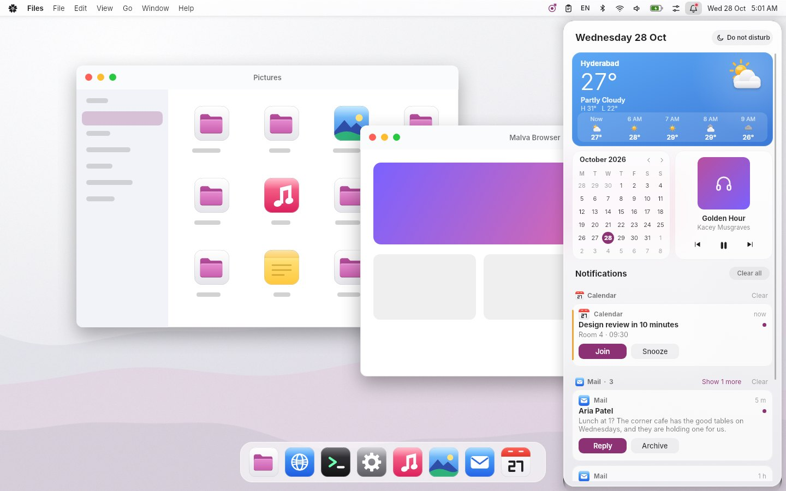

# Menu bar: the Slint frontend

The redesigned Malva OS menu bar and everything that drops from it, as a **Slint** user interface with **SVG**
icons, and a deliberately small **C++ backend** that you are meant to replace. It is the sibling of the Files
redesign and the dock: the same palette, radii and motion curves. The UI owns all drawing and all motion; the backend
says what is on the bar and hears what the person did.



| | |
|---|---|
| `../../docs/screenshots/apps/menubar-*.jpg` | Twenty-three scenes on a desktop (`preview/preview.slint`) plus the elements sheet in light and dark: the bar at rest, the File, system, tray and layout menus, Wi-Fi, Bluetooth, battery, volume, the calendar, the Control Center, the notification centre, toasts, the volume display and the power dialog. |
| `tools/record-demo.py`, `tools/make-filmstrips.py` | Record the compiled app under a real (X11) pointer and cut the run into filmstrips. The recordings themselves are not part of the kit. |

**Built on the Malva kit.** `ui/theme.slint` maps the bar's names onto the kit's `Theme`, `Radius` and `Typo`
(`@malva/malva.slint`), so the bar follows `tokens/malva-tokens.json`: neutral off-white and graphite surfaces, with the
logo's plum / orchid as the only strong colour (the accent of switches, sliders, primary buttons and today in the calendar).

## What is here

```
ui/
  menubar.slint          the one file a backend compiles; exports MenubarWindow, the structs, Theme, Motion, Screen
  menubar-window.slint   the Window: every property and callback a backend uses, in one flat list
  theme.slint            Theme (colours, glass, radii, light/dark), Motion (durations), Screen (the blurred backdrop)
  types.slint            MenuEntry, TrayItem, WifiNetwork, BtDevice, AudioDevice, CalCell, CalEvent, QuickTile,
                         Notice, Weather, Media, Fact
  components/            menubar-panel (the whole surface: what is open, the keyboard, the click-away, the order of
                         things), bar (the strip, its items and glyphs), menu (card, rows, flyout, keyboard),
                         popovers (Wi-Fi, Bluetooth, Battery, Sound, the calendar), control-center,
                         notifications (the centre, cards, banners), osd, power, controls (switch, slider, buttons,
                         ring, spinner), lists, calendar, glyphs, surfaces (glass plate, soft shadow), icon
  icons/app/             19 SVGs: app tiles for the notices, and the weather
  icons/symbols/         73 one-colour symbols, tinted by the theme
preview/                 design scenes with sample data and wallpapers (nothing here ships)
backend/                 the stand-in backend (replace it)
  bar_model.*            the sample machine: menus and what each choice does, networks, devices, battery, volume,
                         calendar and events, tiles, media, notices and their grouping. No Slint.
  app.*                  wires the window's callbacks to the model; what the system does around the bar
  main.cpp               options, run loop, --snapshot, --record, --at
tests/                   model_test (pure logic), app_test (the window and backend, driven by a moving pointer and keys)
tools/                   render-previews.sh, record-demo.py, make-filmstrips.py, make-sample.py, make-symbols.py,
                         make-wallpapers.py, xinput.py
```

## Build and run

You need the Slint C++ SDK 1.18 (built and tested against 1.18.1; other versions are untested), CMake 3.21 and a C++20
compiler.

```sh
cmake -S . -B build -DCMAKE_PREFIX_PATH=/path/to/Slint-cpp-1.18.1-Linux-x86_64 -DCMAKE_BUILD_TYPE=Release -DMENUBAR_APP_TEST=ON
cmake --build build
ctest --test-dir build
./build/menubar [--dark] [--accent=#8c3274] [--desk=#8e8e93] [--size=1440x900] [--battery-percent]
                [--live-clock] [--connect-ms=1100] [--power-seconds=30] [--popup=wifi]
                [--at=SECONDS:EVENT ...] [--log-popups]
```

`slint-compiler` has to be on `PATH` (the SDK's `bin`). Use a GPU renderer (`SLINT_BACKEND=winit-femtovg`, or Skia
if your Slint has it): the software renderer draws no blurred shadows.

The demo draws the bar in an ordinary window, the size of the screen, on a flat "desk" colour. A real bar is a
transparent window along the top of the screen; see *What the window needs* below.

`--at=SECONDS:EVENT` makes the system do something at a time, to be seen: `notify:mail|calendar|store|chat`,
`volume:+0.1`, `volume:-0.1`, `mute`, `brightness:+0.1`, `popup:wifi`, `close`, `power`. `--log-popups` prints what is
open ("popup: menu-1") and every request the bar makes of the system ("request: power:sleep"). `--snapshot=out.ppm`
renders once and exits; `--record=dir` writes the window as numbered frames. `--under=desktop.ppm` is a picture to
composite them over, as a compositor would (the window is clear wherever the bar and its menus are not).

To look at the UI without a backend: `slint-viewer preview/preview.slint --component PreviewRest`. To redraw every
picture here: `tools/render-previews.sh` (needs slint-viewer, Xvfb, python3 with numpy and pillow),
`tools/record-demo.py build/menubar out-dir [--dark]` (needs Xvfb, libX11, libXtst) and
`tools/make-filmstrips.py out-dir pictures-dir [light|dark]` (needs ffmpeg; `--no-video` for the strips alone).

## What the bar does

- **The bar**: the system menu (the Malva mark, from the brand kit's single-colour small mark, tinted by the theme), the app's menus (the first title is the app's name, bold), then on the right
  tray items, the keyboard layout, Bluetooth, Wi-Fi, volume, battery, the Control Center, the notification bell
  (a red dot while there is something unread; a moon instead during Do Not Disturb) and the clock. Each glyph shows
  state: the battery from full down to 5 % (red when low, a bolt when charging, a figure if asked for), Wi-Fi off, not
  connected, or one to three bars, volume muted, zero, low, middle or high.
- **Menus**: a click opens the menu out of its title; the rows arrive 14 ms apart. With one open, resting on
  another title opens that one instead and the card glides to it. A row can have a flyout (it opens after the
  pointer rests 180 ms, and stays open while the pointer is in it). Rows have an icon, a shortcut, a check,
  a destructive style and a disabled state. The keyboard works: Up and Down skip headers, separators and disabled rows,
  Return or Space chooses, Right opens a flyout, Left closes it (or moves to the neighbouring menu), Escape closes.
- **Popovers**: Wi-Fi (networks, a spinner while one connects, a lock for secured ones), Bluetooth (devices with their
  batteries), Battery (the ring, the power mode, health and cycles), Sound (volume, mute, the outputs), and the
  calendar (a month, events as dots, the chosen day's list). With one open, moving along the bar slides from one
  popover to the next.
- **Control Center**: tiles (Wi-Fi and Bluetooth with a chevron to their popovers, Do Not Disturb, Airplane Mode, Dark
  Mode, Night Light), brightness and volume sliders, the player, and Screenshot, Lock and Settings.
- **Notifications**: the centre slides in from the right with today's date, a weather card, a small calendar, the
  player and the notices grouped by app (the first two of a group show; "Show n more" unfolds the rest). A card
  pulled sideways slides away and the rows close up; the pointer on a card shows a close button; buttons on a card
  act and dismiss it. **Banners** spring in from the right edge, wait 5.2 s (the pointer on one holds it) and go by
  themselves, or are answered; Do Not Disturb keeps them off. **The volume display** comes up for the volume,
  brightness and mute keys, steps with each key and goes by itself.
- **Power**: Lock and Sleep are done at once. Restart, Log Out and Shut Down put the screen to frosted glass and count
  down (so nothing is lost by a stray click), with a button to do it now and a click on the glass to cancel.

## Writing your backend

Compile `ui/menubar.slint`, then `#include "menubar.h"` and create a `MenubarWindow`. `backend/app.cpp` is a complete
working example of everything below, and `backend/bar_model.*` shows one way to keep the state.

**Give it** (properties on `MenubarWindow`, all with `set_` setters):

| property | meaning |
|---|---|
| `menus` `[string]`, `tray` `[TrayItem]`, `layout-text`, `clock-text` | what is on the bar. The first title is the app's name. `clock-text` is as you format it, so the locale is yours. An empty `layout-text` hides the layout item. |
| `wifi-enabled`, `wifi-connected`, `wifi-strength` (0 to 3), `wifi-networks` `[WifiNetwork]` | the Wi-Fi glyph and its popover. A network has `name`, `strength`, `secured`, `connected`, `connecting`, `saved`. |
| `bluetooth-enabled`, `bluetooth-devices` `[BtDevice]` | `name`, `icon`, `connected`, `connecting`, `battery` (percent, -1 for unknown). |
| `has-battery`, `battery`, `charging`, `show-battery-percent`, `battery-status`, `battery-detail`, `battery-source`, `power-modes`, `power-mode`, `battery-facts` | the battery glyph and popover. |
| `volume`, `muted`, `audio-outputs` `[AudioDevice]`, `brightness` | 0 to 1. |
| `cal-title`, `cal-weekdays`, `cal-weekdays-short`, `cal-cells` (42 `CalCell`), `cal-day-title`, `cal-events` `[CalEvent]` | the calendar. You move months and days; the window asks. |
| `quick-tiles` `[QuickTile]`, `media` `Media` | the Control Center: tiles have `id`, `icon`, `title`, `subtitle`, `on`, `enabled`, `detail` (a chevron). `media.has-media` false hides the player. |
| `notices` `[Notice]`, `dnd`, `unread`, `date-text`, `weather` | the centre. **Keep `notices` sorted by group, newest first inside a group, and fill `group-index` and `group-count`**: the UI stacks and folds without counting. |
| `toasts` `[Notice]` | the banners on the screen now. A banner is a notice with `group-index` 0 and `group-count` 1. |
| `power-user`, `power-countdown` | the name for the power dialog, and the seconds it counts. |
| `menu-entries` `[MenuEntry]` | the open menu's rows (see below). |
| `dark`, `accent`, `desk`, `backdrop`, `has-backdrop`, `backdrop-width/height` | the look. `desk` is what shows where the window draws nothing (a demo); leave it clear. `backdrop` is a blurred copy of the wallpaper, the size of the screen, for the glass to show; without one the glass is plain translucent. |

**Hear it** (`on_...` callbacks): `popup_changed(name)`, `menu_requested(name)`, `menu_chosen(name, row)`,
`wifi_toggled(on)`, `wifi_network_clicked(i)`, `wifi_settings`, `bluetooth_toggled(on)`, `bluetooth_device_clicked(i)`,
`bluetooth_settings`, `power_mode_picked(i)`, `battery_settings`, `volume_edited(v)`, `mute_toggled`,
`output_clicked(i)`, `sound_settings`, `brightness_edited(v)`, `calendar_previous/next/today/picked(i)/open`,
`tile_toggled(i)`, `tile_detail(i)`, `control_action(name)`, `media_previous/play_pause/next`, `notice_clicked(i)`,
`notice_action(i, a)`, `notice_removed(i)`, `group_cleared(group)`, `notices_cleared`, `dnd_toggled(on)`,
`toast_clicked(i)`, `toast_action(i, a)`, `toast_closed(i)`, `toast_expired(i)`, `power_chosen(action)`,
`power_cancelled`.

**Do things to it** (public functions): `show_popup(name)`, `close_popup()`, `show_osd(kind, value, label)` (kind is
`volume`, `brightness`, `mute` or `text`), `open_power()`, `ask_power(action)` (open already counting down).

**Read it**: `popup` ("" for nothing, else `system`, `menu-N`, `tray-N`, `layout`, `wifi`, `bluetooth`, `volume`,
`battery`, `control`, `bell`, `clock`), `something-open`, `toasts-height`, `osd-showing/kind/value`,
`power-pending/remaining/view`, and the open menu's `menu-x/y/width/height`, `menu-cursor`, `menu-sub`,
`menu-sub-cursor`, `flyout-x/y`. Where bar items are is not exported (their layout follows their content); a test or
a recording finds them by sweeping the pointer with a popup open and reading `popup` (see `tools/record-demo.py`).

Rules that are easy to miss:

1. **Menus are filled on request.** When one is about to open the window calls `menu_requested(name)`; set
   `menu-entries` in that handler, because the window reads the rows as soon as it returns. A row is `text`, `kind`
   (`item`, `header`, `separator`), `shortcut`, `icon`, `checked`, `enabled`, `destructive`, `submenu` and `parent`:
   a row with `submenu` set opens a flyout of the rows after it whose `parent` is its index. `menu_chosen(name, row)`
   says which; the menu closes itself.
2. **Rows change in place.** Keep `id` stable in `notices` and `toasts`. The UI matches rows by position, so insert,
   erase and `set_row_data` on the model you gave it, instead of replacing the whole model: that is what lets a card
   that stays be the same card (its slide, its fold) and one that arrives or leaves do only that. `App::assign` and
   `App::syncNotices` show it.
3. **A card tells you when it has gone.** A pulled or answered notice slides away, closes up, and *then* calls
   `notice_removed(i)`; drop that row then. The same for a banner and `toast_expired(i)` (its time is up, or it was
   closed). A banner that has left the model stays on the screen until the window says it has gone.
4. **Clicks and drags are the UI's to tell apart.** A press that moves more than 6 px is a drag and never a click;
   a pull of more than 90 px dismisses a card.
5. **Popovers are yours to fill and the window's to place.** It opens on `show_popup` or a click, closes on a click
   anywhere else or Escape, and calls `popup_changed`. Set what a popover shows before it opens, or on
   `popup_changed` (the stand-in puts the calendar on today when the calendar or the bell opens).
6. **The bell reads the notices only after a look.** The stand-in marks them read when the centre closes and has been
   open 600 ms, so a pointer passing over the bell does not read them. That rule is the backend's.
7. **Everything the bar asks of the system goes out as a request**, which the stand-in only records
   (`App::requests()`, `onRequest`): `power:lock|sleep|restart|shutdown|logout`, `open:settings|store|calendar`,
   `settings:wifi|bluetooth|battery|sound`, `wifi:password:<network>`, `tile-detail:<id>`, `notice:open:<app>`,
   `notice:action:<app>:<button>`, `app:*`, `file:*`, `edit:*`, `view:*`. Yours act on them.

### What the window needs

`MenubarWindow` is the screen's whole top: the bar is its first 30 px, and the rest is clear, which is room for the
menus, the popovers, the notification centre (408 px, from the right edge, down the screen), the banners (a 380 px
column against the right edge, `toasts-height` tall), the volume display and the power dialog. Make it the screen's
width and about as tall as the screen (the centre and the power dialog use all of it), transparent. Pass pointer
events through everywhere but the bar, the open menu or popover, the banners and the volume display; while
`something-open` is true take them everywhere, so a click outside closes what is open. Frameless transparent windows
need a compositor that blends alpha. None of the window management (the layer-shell surface and its exclusive zone,
input regions, keyboard grab while a menu is open, `onPopup` is there for that) is in this project.

## Motion and colour

Everything tunable is in `ui/theme.slint`. `Motion`: a popover or menu grows out of its item in 220 ms and shrinks back
in 140; menu rows arrive 14 ms apart; the card glides 200 ms between bar items; a flyout waits 180 ms; a switch 200;
panels slide in 340 and out 220; banners come in 380 ms, live 5200 and leave 260; cards in the centre arrive 26 ms
apart and are dismissed in 240; the volume display comes in 200 ms, lives 1500 and leaves 320; the power dialog 260. `Theme`: the palette,
the glass tints, rim, hairline and sheen in light and dark, the surfaces inside panels, the status colours. The four
curves are the Files app's and the dock's: standard (0.2, 0, 0, 1), soft (0.4, 0, 0.2, 1), overshoot
(0.34, 1.35, 0.64, 1) and exit (0.4, 0, 1, 1).

Shadows are drawn as fading 1 px rings, not a blur, so they never tint the translucent glass they surround.

## Tested, and not

Verified here: the UI compiles without warnings; the scenes and sheets render in light and dark; the C++ backend builds
against the SDK; `ctest` runs `model_test` and `app_test` (`-DMENUBAR_APP_TEST=ON`, which needs Slint's testing backend,
in the SDK). `app_test` moves a pointer and presses keys through the window's own event handling, with time stepped by
hand, and checks: the initial state; that each bar item opens what it should (found by sweeping, as the recorder
does); the menus (a click, disabled and separator rows, toggles, a click on the desk, the hand-over from one menu to
the next, the keyboard in full, a flyout by keys and by pointer); the system menu and the power rows (Sleep and Lock at
once; Restart counts down and acts, Escape cancels, a click on the glass cancels, and a cancelled countdown fades as a
countdown); Wi-Fi (a secured unsaved network asks for its password, a saved one connects, the switch), Bluetooth,
Battery, Sound; the calendar; the Control Center (tiles, Airplane Mode, the chevrons, both sliders, the player, Lock);
the media clock; the notification centre (it reads after a dwell and not before, a swipe is not a click, a card's
buttons, a pulled card closes up and the group's header and count follow, Clear all); banners (their life, held by the
pointer, a button, a click, Do Not Disturb); the volume display; the dark property. A mutation of the code (breaking
a rule) was run against the tests to see that they notice.

Verified with slint-viewer: all 23 scenes and both element sheets were rendered from a clean unzip with
`slint-viewer ... --component ... --screenshot`, were pixel-identical to the screenshots shipped here, and were
looked at one by one.

Verified by recording: the compiled app was run under Xvfb with Slint's `winit-femtovg` renderer and driven by a real
X pointer (XTest); the app snapshots its own window about every 40 ms and puts it over the desktop picture as a
compositor would (a snapshot's pixels are premultiplied). The filmstrips, GIFs and videos are those frames.

Running the tests and the recordings found real bugs, all fixed: a click on a disabled tile or on a card's own surface
fell through to the click-away and closed the popover; a swipe that dismissed a card also counted as a click and opened
the app; a pointer passing over the bell marked everything read; the last menu's title was found at the wrong place (the gap before the tray); and, in the recordings, a
cancelled power countdown flashed the list of choices as it faded, and the film compositor treated premultiplied
pixels as straight so that cards looked grey while fading in.

**Not verified:** the animations were watched as frames, not on a display at its refresh rate, so timings and curves
are specified and sampled but their feel is untested. Nor: a GPU or a Wayland compositor; a layer-shell surface (the
exclusive zone, input regions, a keyboard grab); transparency as a real compositor blends it (the stand-in blends it
itself, over a picture); high-DPI scales; real compositor blur behind the glass (the previews use a pre-blurred
wallpaper through `backdrop`); any real system service (NetworkManager, BlueZ, UPower, PulseAudio or PipeWire, a
notification daemon, a calendar, a media player): the backend is a sample machine; other non-Latin scripts in the
keyboard-layout menu (Hindi's Devanagari name was looked at in a render here and is right, with the fonts this
machine has; what shows on yours depends on its fonts); system icon themes; the right-to-left
layouts.

**Known rough edges:** "Clear all" and a group's "Clear" remove the rows at once, without the closing-up a single
card gets; when a card is dismissed the groups are sorted again by their newest member, and a group may jump below
another without moving there; the wheel scrolling of the Wi-Fi, Bluetooth, events and notification lists is in the UI
but no test or recording scrolls it; the keyboard is covered for menus only (Tab into a popover is untried).

**Not included:** a real window manager's part (above), a full Control Center (more tiles, a screen-recording
control), accessibility, touch, drag and drop onto the bar, tray items that bring their own popover (a tray item opens
a menu), and per-app notification settings. The sample apps, wallpapers, notices and the mock desktop in `preview/`
are stand-ins.

## Licence

No licence is applied to these files; choose one that suits where they go. Slint itself is offered under GPL-3.0, a
royalty-free licence, or a commercial one: check which applies to you.
