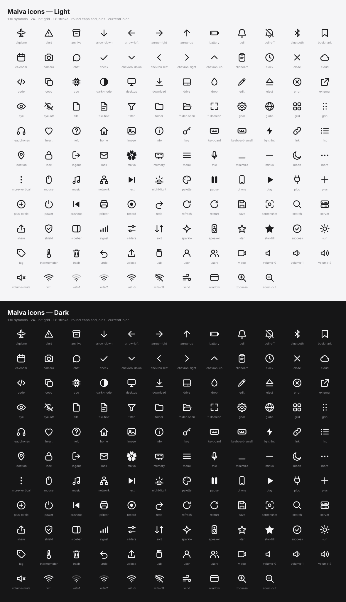

<!-- GENERATED by tools/gen_icons.py from svg/icons, svg/app and svg/logo. Do not edit by hand. -->
# Malva icons

130 one-colour symbols, 20 application pictures and 11 brand lock-ups.

Symbols are drawn on a 24-unit grid with a 1.8 stroke, round caps and joins, and use `currentColor`, so they take the
colour of the text they sit in (CSS), `tint` (Slint `Icon`), or [`svg_with_color`] (Rust). Sizes: 16 / 20 / 24.

## Symbols

`airplane`, `alert`, `archive`, `arrow-down`, `arrow-left`, `arrow-right`, `arrow-up`, `battery`, `bell`, `bell-off`, `bluetooth`, `bookmark`, `calendar`, `camera`, `chat`, `check`, `chevron-down`, `chevron-left`, `chevron-right`, `chevron-up`, `clipboard`, `clock`, `close`, `cloud`, `code`, `copy`, `cpu`, `dark-mode`, `desktop`, `download`, `drive`, `drop`, `edit`, `eject`, `error`, `external`, `eye`, `eye-off`, `file`, `file-text`, `filter`, `folder`, `folder-open`, `fullscreen`, `gear`, `globe`, `grid`, `grip`, `headphones`, `heart`, `help`, `home`, `image`, `info`, `key`, `keyboard`, `keyboard-small`, `lightning`, `link`, `list`, `location`, `lock`, `logout`, `mail`, `malva`, `memory`, `menu`, `mic`, `minimize`, `minus`, `moon`, `more`, `more-vertical`, `mouse`, `music`, `network`, `next`, `night-light`, `palette`, `pause`, `phone`, `play`, `plug`, `plus`, `plus-circle`, `power`, `previous`, `printer`, `record`, `redo`, `refresh`, `restart`, `save`, `screenshot`, `search`, `server`, `share`, `shield`, `sidebar`, `signal`, `sliders`, `sort`, `sparkle`, `speaker`, `star`, `star-fill`, `success`, `sun`, `tag`, `thermometer`, `trash`, `undo`, `upload`, `usb`, `user`, `users`, `video`, `volume-0`, `volume-1`, `volume-2`, `volume-mute`, `wifi`, `wifi-1`, `wifi-2`, `wifi-3`, `wifi-off`, `wind`, `window`, `zoom-in`, `zoom-out`

## Application pictures

`browser`, `calculator`, `calendar`, `default`, `editor`, `files`, `launcher`, `mail`, `music`, `notes`, `photos`, `settings`, `store`, `terminal`, `video`, `weather-clear`, `weather-cloudy`, `weather-night`, `weather-partly`, `weather-rain`

## Logos

`malva-app-icon`, `malva-bloom`, `malva-logo-horizontal`, `malva-logo-horizontal-reverse`, `malva-logo-stacked`, `malva-logo-stacked-reverse`, `malva-mark`, `malva-mark-black`, `malva-mark-white`, `malva-wordmark`, `malva-wordmark-white`
